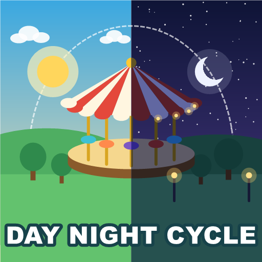

# Day Night Cycle

A [Parkitect](https://www.themeparkitect.com/) mod where the sun crosses the sky. The game can switch between day and night, but the sun stays in the same place. With this mod the shadows follow the sun, and the park goes through sunrise, sunset and a gradual night.

[Steam Workshop page](https://steamcommunity.com/sharedfiles/filedetails/?id=3832725912)



## What it does

- The sun rises, crosses the sky and sets, and the shadows move with it.
- The light and the sky turn warm near sunrise and sunset.
- The light fades into a dark night with a blue moonlight.
- The park's lights turn on at dusk and off at dawn.
- The clock follows the park's time, so it pauses and speeds up with the game.

## How to use it

Open a park and the cycle is already running. Press **H** to open the window. The key can be changed in the game's controls settings.

- **Day and night cycle** turns the mod on or off.
- **Stop the clock** holds the current hour.
- **Time of day** takes you to any hour.
- **Day length** sets how long a full day takes, from 1 to 24 of the game's weeks. The default is 6, the same as the game's own automatic cycle.
- **Sunset color** sets how warm the sunrise and sunset look.

Your values are saved when you close the window, and they apply to all your parks.

## Good to know

- While the cycle is on, it decides when it's night, so the game's own day and night button has no effect. Turn the cycle off to get the button back.
- Rain still dims the sun and removes the shadows, and a builder window still brightens the night.
- It can't be used in multiplayer yet, because it hasn't been tested with two players.

## Building

You need the .NET SDK and Parkitect installed.

```bash
dotnet build -c Release
```

The build copies the mod and the preview into `Documents/Parkitect/Mods/day_night_cycle`. If the game or the mods folder is somewhere else:

```bash
dotnet build -c Release -p:ParkitectManaged="<Parkitect>/Parkitect_Data/Managed" -p:ModOutputDir="<mods folder>/day_night_cycle"
```

## Code

| File | What it does |
| --- | --- |
| `src/day_night_cycle_mod.cs` | Entry point and key |
| `src/sky_controller.cs` | Moves the sun, colors the light and sky, and switches night on and off |
| `src/cycle_window.cs` | The in-game window |
| `src/cycle_settings.cs` | Settings, saved between parks |

## License

[MIT](LICENSE)
